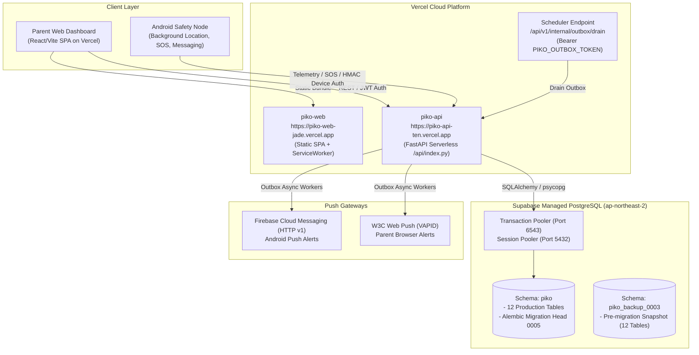

# Piko Initial Deployment Reference

## A. System Architecture



---

## B. Verified Live Endpoints & Flows

### 1. API Health Check (`/api/v1/health/ready`)
Verified against live Vercel backend and Supabase database:
```bash
curl -s -i https://piko-api-ten.vercel.app/api/v1/health/ready
```
**Response:**
```http
HTTP/2 200
content-type: application/json
strict-transport-security: max-age=31536000; includeSubDomains; preload
x-content-type-options: nosniff
x-frame-options: DENY

{"status":"ready","database":"ok","checks":{"database":{"status":"ok"}}}
```

### 2. Frontend Security Headers & CSP (`piko-web`)
Verified against live Vercel frontend:
```bash
curl -s -i https://piko-web-jade.vercel.app/
```
**Response Headers:**
```http
HTTP/2 200
content-type: text/html; charset=utf-8
content-security-policy: default-src 'self'; script-src 'self'; style-src 'self' 'unsafe-inline' https://fonts.googleapis.com; font-src 'self' https://fonts.gstatic.com; img-src 'self' data: blob: https://*.tile.openstreetmap.org; connect-src 'self' https://piko-api-ten.vercel.app; frame-ancestors 'none';
x-content-type-options: nosniff
x-frame-options: DENY
```

### 3. Database Readiness & Schema Separation
Verified via Supabase MCP:
- Schema `piko` contains all 12 operational tables (Alembic migration head `0005`).
- Schema `public` contains 0 tables (hard isolation maintained).
- Snapshot schema `piko_backup_0003` contains verified pre-migration state.

---

## C. Public API Endpoints

All endpoints are hosted at `https://piko-api-ten.vercel.app/api/v1`.

| Method | Endpoint | Auth | Purpose |
|---|---|---|---|
| `GET` | `/health/live` | None | Liveness probe (returns `{"status":"ok"}`) |
| `GET` | `/health/ready` | None | Readiness probe with database connectivity check |
| `POST` | `/auth/register` | None | Initial parent registration |
| `POST` | `/auth/login` | None | Password login; returns access JWT & set-cookie refresh token |
| `POST` | `/auth/refresh` | Cookie / Bearer | Refresh token rotation with reuse detection (ADR-019) |
| `POST` | `/auth/logout` | User Bearer | Revokes current session |
| `POST` | `/families/invite-codes` | Guardian Bearer | Generate one-time member invitation code |
| `POST` | `/families/join` | User Bearer | Join family using invitation code |
| `POST` | `/devices/pair/request` | User Bearer | Generate 9-character device pairing code (ADR-008) |
| `POST` | `/devices/pair` | None (HMAC) | Complete device pairing with token issuance |
| `POST` | `/devices/telemetry` | Device Token | Batch ingest telemetry events (idempotent) |
| `GET` | `/families/summary` | User Bearer | Parent dashboard family members & latest locations |
| `GET` | `/members/{id}/history` | User Bearer | Location & telemetry trail (time-bounded) |
| `POST` | `/sos/incidents` | Device / User | Trigger emergency SOS incident |
| `GET` | `/sos/incidents/{id}` | User Bearer | Fetch SOS incident detail (rate-limited) |
| `PUT` | `/sos/incidents/{id}` | User Bearer | Acknowledge or resolve SOS incident |
| `POST` | `/messages` | Any Principal | Send safety message (phone <-> parent) |
| `GET` | `/messages` | Any Principal | List messages with optional sender filter |
| `POST` | `/push/register-device` | Device Token | Register Android FCM token |
| `POST` | `/push/register-web` | User Bearer | Register browser Web Push subscription |
| `POST` | `/internal/outbox/drain` | Outbox Token | Worker trigger: drain notification queue |
| `POST` | `/internal/retention/run` | Outbox Token | Worker trigger: run data retention prune |

---

## D. Database Architecture

- **Provider:** Supabase PostgreSQL
- **Project Ref:** `wktsqtydgfmmmugngzxo`
- **Region:** `ap-northeast-2` (Seoul)
- **Direct / Session Connection:** Port `5432` (`db.wktsqtydgfmmmugngzxo.supabase.co`)
- **Connection Pooler (PgBouncer):** Port `6543` (`aws-0-ap-northeast-2.pooler.supabase.com`)
  - Note: Vercel serverless runtime uses session pooler or transaction pooler with `prepare_threshold=0` for PgBouncer compatibility.

### Migrations Status (Schema `piko`)
1. `0001_initial_schema`: Base users, families, memberships, devices, audit log.
2. `0002_pairing_and_refresh`: Pairing invitations and refresh sessions.
3. `0003_telemetry_and_state`: Telemetry events (append-only) and device latest state.
4. `0004_safety_sos_messages`: SOS incidents and safety messaging tables.
5. `0005_push_notifications`: Device push tokens, web push subscriptions, and notification outbox.
**Current Schema Version:** `0005 (head)`

### Table Catalog (`piko` schema)
1. `users`: Parent/child user accounts (Argon2id password hashes).
2. `families`: Family tenancy unit.
3. `family_memberships`: Role-based membership (`guardian`, `parent`, `child`).
4. `devices`: Enrolled physical nodes with device-level encryption metadata.
5. `device_credentials`: HMAC pairing keys and rotating token hashes.
6. `pairing_invitations`: Time-limited, single-use 9-character pairing codes.
7. `member_invitations`: Family member invitation codes.
8. `refresh_sessions`: Cryptographically rotated refresh tokens with reuse lineage.
9. `audit_events`: Security event log.
10. `telemetry_events`: Append-only time-series location, battery, and network status.
11. `device_latest_state`: Denormalized materialized view of latest device readings.
12. `sos_incidents`: High-priority safety alerts with lifecycle tracking.
13. `messages`: Bidirectional safety messaging.
14. `device_push_tokens`: Android FCM registration tokens with TTL.
15. `web_push_subscriptions`: Parent browser W3C Web Push endpoints with VAPID keys.
16. `notification_outbox`: Transactional outbox for guaranteed push delivery.
17. `alembic_version`: Migration tracker.

---

## E. Vercel Deployment

### 1. API Service (`piko-api`)
- **Project ID:** `prj_I1BtFgM2j00h162wDqwY9KgpYk3a`
- **Production URL:** `https://piko-api-ten.vercel.app`
- **Preview Pattern:** `https://piko-*-therealneelakshs-projects.vercel.app`
- **Framework:** Python Serverless (WSGI/ASGI via FastAPI)
- **Entrypoint:** `backend/api/index.py` (Vercel standard serverless function directory)
- **Rewrites (`backend/vercel.json`):**
  ```json
  {
    "rewrites": [{ "source": "/(.*)", "destination": "/api/index.py" }]
  }
  ```
- **Configured Environment Variables (Production & Preview):**
  - `PIKO_ENV`: `production`
  - `PIKO_DATABASE_URL`: Supabase connection URI
  - `PIKO_DB_SCHEMA`: `piko`
  - `PIKO_JWT_PRIVATE_KEY`: RSA-4096 PEM private key
  - `PIKO_JWT_PUBLIC_KEY`: RSA-4096 PEM public key
  - `PIKO_HMAC_KEY`: 32-byte hex secret for device pairing HMAC
  - `PIKO_CORS_ORIGINS`: `["https://piko-web-jade.vercel.app","https://*.vercel.app"]`
  - `PIKO_ALLOWED_HOSTS`: `["piko-api-ten.vercel.app","*.vercel.app","localhost","127.0.0.1"]`
  - `PIKO_OUTBOX_TOKEN`: High-entropy internal execution secret (>= 32 bytes)
  - `PIKO_VAPID_PRIVATE_KEY` / `PIKO_VAPID_PUBLIC_KEY`: Web Push VAPID keypair
  - `PIKO_VAPID_SUBJECT`: Operator contact email (`mailto:...`)

### 2. Frontend Service (`piko-web`)
- **Project ID:** `prj_Os28g3QEAlrShYzS0ULpwOqMBQEj`
- **Production URL:** `https://piko-web-jade.vercel.app`
- **Framework:** Vite + React + TypeScript
- **Build Output Directory:** `web/dist`
- **Environment Variables:**
  - `VITE_API_BASE`: `https://piko-api-ten.vercel.app`
  - `VITE_TILE_URL`: `https://tile.openstreetmap.org/{z}/{x}/{y}.png`
- **SPA Rewrites (`web/vercel.json`):**
  Routes all unknown paths to `/index.html` for client-side routing.

---

## F. Android Node & APK Release

### 1. Build & Automation
- **GitHub Actions Workflow:** `.github/workflows/android-apk.yml`
- **Triggers:** Push to `main` or `deployment`, tags `v*`, or manual `workflow_dispatch`.
- **JDK:** OpenJDK 17 (Eclipse Temurin)
- **Gradle:** 9.8.1 wrapper
- **Artifact Name:** `piko-android-debug-apk`
- **Artifact Path:** `android/app/build/outputs/apk/debug/app-debug.apk`

### 2. Operator Configuration (Firebase / FCM)
- The Android app architecture maintains complete isolation from hardcoded secrets.
- To enable live Firebase Cloud Messaging:
  1. Register package `com.piko.node` in the Firebase Console.
  2. In `android/local.properties` (gitignored), configure:
     ```properties
     piko.firebase.project_id=your-firebase-project-id
     piko.firebase.application_id=1:123456789:android:abcdef
     piko.firebase.api_key=AIzaSy...
     ```
  3. On Vercel (`piko-api`), set `PIKO_FCM_SERVICE_ACCOUNT_B64` containing the base64-encoded Firebase Service Account JSON.
- **Graceful Fallback:** If Firebase configuration is omitted, `PushSupport.configured()` evaluates to `false`. The app runs normally using its durable local store-and-forward SQLite engine and polling transport without crashing or dropping safety events.

---

## G. Security Posture

1. **Local-Only & Sovereign Policy:** No SaaS dependencies required for core functionality. Supabase can be replaced with any standard PostgreSQL 16 instance.
2. **Cryptographic Key Storage:** RSA-4096 and HMAC keys are stored encrypted in Vercel environment variables and injected at process startup into memory.
3. **Session Hardening (ADR-019):** Refresh tokens rotate on every exchange. If a used token is reused, all tokens in the lineage family are immediately revoked.
4. **Device Pairing Hardening (ADR-008):** 9-character pairing codes expire after 15 minutes. Pairing verification uses constant-time HMAC comparison.
5. **Data Minimization (ADR-023):** Push notifications contain minimal generic alerts (e.g., "Safety alert update") without revealing raw location coordinates or sensitive messages on the device lock-screen.
6. **Network Security:** Strict Content-Security-Policy, HTTP Strict Transport Security (`max-age=31536000`), `X-Frame-Options: DENY`, `X-Content-Type-Options: nosniff`.

---

## H. Disaster Recovery & Rollback

### Verified Backup Snapshot
A complete pre-migration schema snapshot was created and verified prior to applying Phase 6 migrations:
- **Snapshot Schema Name:** `piko_backup_0003` in Supabase project `wktsqtydgfmmmugngzxo`.
- **Contents:** Full copy of all 12 baseline tables including data and indexes.

### Restoration Procedure
To revert the database to the pre-push state:
```sql
-- 1. Terminate active backend connections
SELECT pg_terminate_backend(pid) FROM pg_stat_activity WHERE datname = 'postgres' AND pid <> pg_backend_pid();

-- 2. Drop current schema and recreate from snapshot
DROP SCHEMA piko CASCADE;
CREATE SCHEMA piko;

-- 3. Copy all tables from verified backup
DO $$
DECLARE
    r RECORD;
BEGIN
    FOR r IN (SELECT tablename FROM pg_tables WHERE schemaname = 'piko_backup_0003') LOOP
        EXECUTE format('CREATE TABLE piko.%I AS TABLE piko_backup_0003.%I', r.tablename, r.tablename);
    END LOOP;
END $$;
```

### Verification Query
```sql
SELECT schemaname, tablename, hasindexes
FROM pg_tables
WHERE schemaname = 'piko'
ORDER BY tablename;
```

---

## I. Operational Runbook

### 1. Draining Notification Outbox
Because Vercel is a serverless platform without permanent background daemons, the transactional notification outbox can be drained periodically via an external cron scheduler (e.g., GitHub Actions scheduler or cron-job.org):
```bash
curl -X POST https://piko-api-ten.vercel.app/api/v1/internal/outbox/drain \
  -H "Authorization: Bearer <PIKO_OUTBOX_TOKEN>" \
  -H "Content-Type: application/json" \
  -d '{"batch_size": 50}'
```

### 2. Running Data Retention Prune
To prune telemetry and audit events older than the configured retention policy:
```bash
curl -X POST https://piko-api-ten.vercel.app/api/v1/internal/retention/run \
  -H "Authorization: Bearer <PIKO_OUTBOX_TOKEN>"
```

### 3. Log Inspection
To view live serverless function logs:
```powershell
vercel logs https://piko-api-ten.vercel.app
```

---

## J. Status Matrix

| Component | Environment | Status | URL / Location | Verification Notes |
|---|---|---|---|---|
| **Parent Web App** | Vercel Production | **DEPLOYED & VERIFIED** | `https://piko-web-jade.vercel.app` | React SPA loaded, CSP verified, connects to API |
| **API Backend** | Vercel Production | **DEPLOYED & VERIFIED** | `https://piko-api-ten.vercel.app` | `/health/ready` returns `status: ready`, `database: ok` |
| **Database** | Supabase Cloud | **DEPLOYED & VERIFIED** | `wktsqtydgfmmmugngzxo` (`piko`) | Migrations 0001–0005 applied, head verified |
| **Database Backup** | Supabase Cloud | **DEPLOYED & VERIFIED** | `piko_backup_0003` | Snapshot with 12 tables and rows preserved |
| **Android APK** | GitHub Actions | **AUTOMATED & VERIFIED** | `.github/workflows/android-apk.yml` | Debug APK generated as artifact; JVM tests passing |
| **CI Pipeline** | GitHub Actions | **VERIFIED** | `.github/workflows/ci.yml` | Backend (378 tests), Web (135 tests), Android (102 tests) pass |
| **Push Outbox** | Vercel + Supabase | **DEPLOYED** | `/api/v1/internal/outbox/drain` | Outbox schema deployed, token authenticated |
| **Push Transports**| Vercel Serverless | **CONFIGURED** | FCM v1 & WebPush VAPID | Handlers ready; awaits operator Firebase console credentials |
